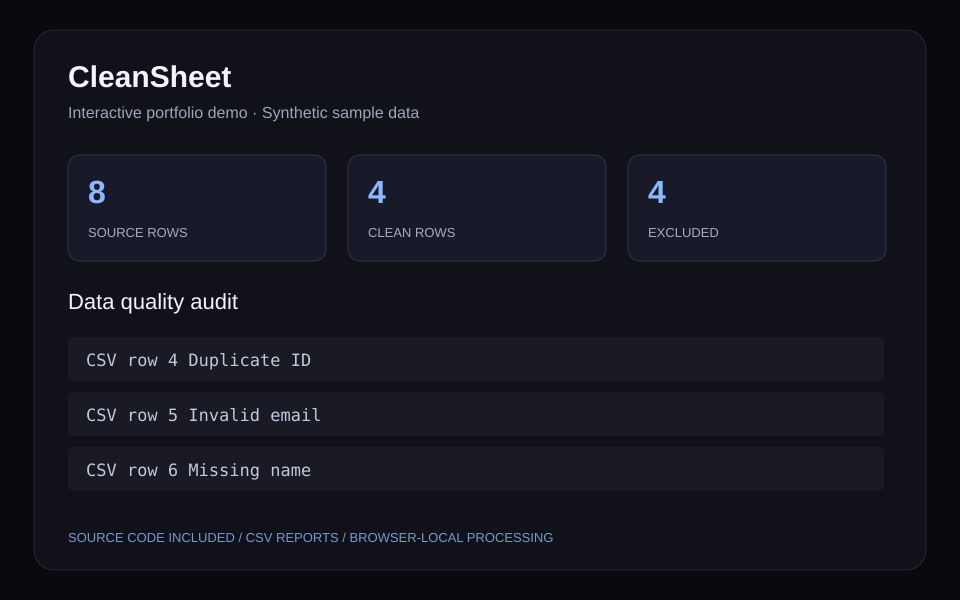

# CleanSheet — CSV Quality Auditor

Upload a CSV, find missing values, invalid emails, and duplicate IDs, then export a cleaned dataset with a row-level audit report. All processing stays in your browser.

[](https://github.com/DEEPSXPLOIT/cleansheet-data-quality/actions/workflows/ci.yml)

## Why this project

Messy records undermine reports and create avoidable operational rework.

A repeatable audit normalizes whitespace and email casing, checks required fields, and excludes invalid rows and subsequent duplicate IDs.

## Features

- Load sample data or upload a CSV
- See row-specific issues and quality metrics
- Compare source records with accepted clean rows
- Download clean records and an audit report

## Run locally

Use Node.js 22 or newer and npm. No API keys, account, or database setup is required.

```bash
git clone https://github.com/DEEPSXPLOIT/cleansheet-data-quality.git
cd cleansheet-data-quality
npm ci
npm run dev
```

Open http://localhost:3013. The dedicated port allows these showcase apps to run alongside the portfolio.

```bash
npm test
npm run build
```

The build produces a static site in `out/`; serve that folder with any static web host. `npm run start` serves the exported build after `npm run build`.

## A quick recruiter walkthrough

1. Load the sample: 8 input rows become 4 accepted rows, with 3 invalid rows and 1 duplicate.
2. Upload a CSV and inspect row-level audit messages.
3. Export clean records and the audit report.

## Input schema

```text
id, name, email, department
```

Column names are case-sensitive. CSV uploads are limited to 1 MB and 2,000 rows. [Download the synthetic sample](public/sample-data.csv).

## Architecture

- `src/components/Application.js`: interactive dashboard and local state
- `src/lib/projectAnalytics.js`: independently tested CSV processing and analytics rules
- `src/data/demoData.js`: synthetic records
- `tests/`: parsing and project-specific regression checks
- `src/app/`: Next.js entry point with server-rendered styled-components setup

The implementation uses React, Next.js, styled-components, and plain JavaScript. All data processing happens in the browser. The reusable analytics module includes helpers shared across the five independently runnable projects.

## Preview illustration



This original illustration summarizes the sample interface; it is not an employer-system screenshot.

## Scope

Validation follows the documented four-column schema and practical email checks. Invalid rows are excluded rather than guessed or imputed. Maximum 2,000 rows / 1 MB per upload.

This is an independent portfolio project. It contains synthetic samples and no employer records. Uploaded files stay in memory; browser-local persistence is used only where the UI says so. Exported CSV cells are quoted and spreadsheet formula prefixes are neutralized.

## Author

Jaideep Mahendra · [GitHub](https://github.com/DEEPSXPLOIT) · [LinkedIn](https://linkedin.com/in/jaideep-mahendra)
